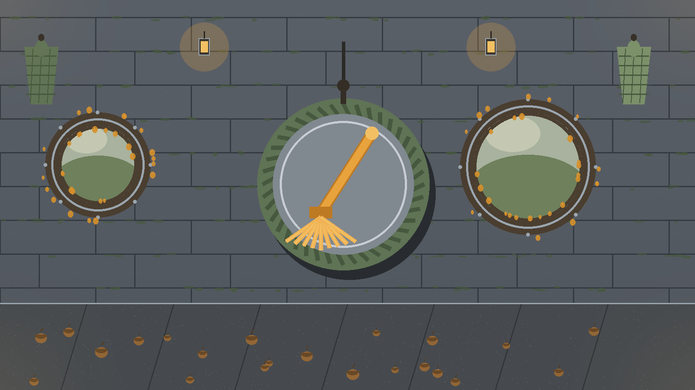
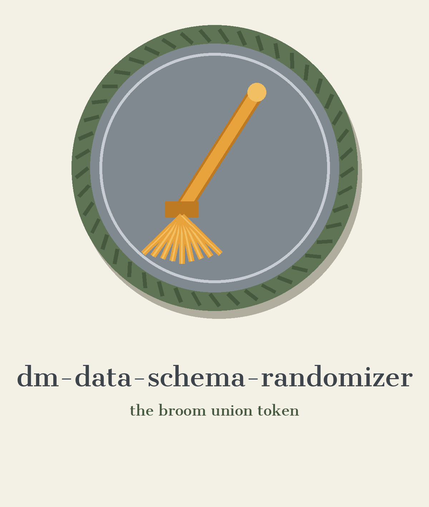

# dm-data-schema-randomizer

Chapter opening, steward first: the name above is set in Cantata One in troll bridge grey, with a small ring beside this title block and the broom badge drawn once as a header plate under the banner. Later headings keep the chapter dress, minus that plate.

# dm-data-schema-randomizer
Randomly renames, reorders, and changes the data types of columns in a dataset to obfuscate its structure. Preserves data integrity within constraints to maintain usability while scrambling the schema. - Focused on Tools designed to generate or mask sensitive data with realistic-looking but meaningless values

## Install
`git clone https://github.com/ShadowGuardAI/dm-data-schema-randomizer`

> Storybook aside: the README clone line spells the organisation without its hyphen.

## Usage
`./dm-data-schema-randomizer [params]`

## Parameters
- `-h`: Show help message and exit
- `--seed`: Random seed for reproducibility.

The output file must not be the input file. A run that names the same file for both, in any spelling that resolves to the same path, is refused at exit 1 before any write.

> Storybook aside: output must not be the input file.

> Storybook aside: any spelling resolving to the same path is still the same file.

> Storybook aside: a matching run is refused at exit 1 before any write.

## License
Copyright (c) ShadowGuardAI

## After the flood, the minutes

The main button of this re-skin reads Scramble the Schema. Its seed field label reads Union Seed. Its guard heading reads Output Is Never the Input. Its agenda heading reads Controls, All Two of Them. It ends with the badge back on its peg on the last page, the spell kept, the hall at rest, and the brooms drying by the wall.
